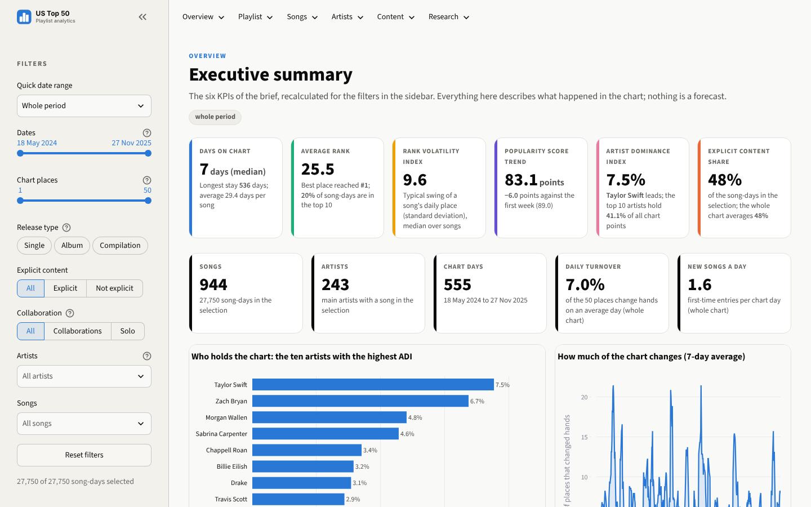
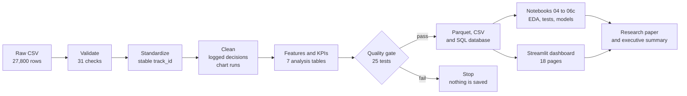
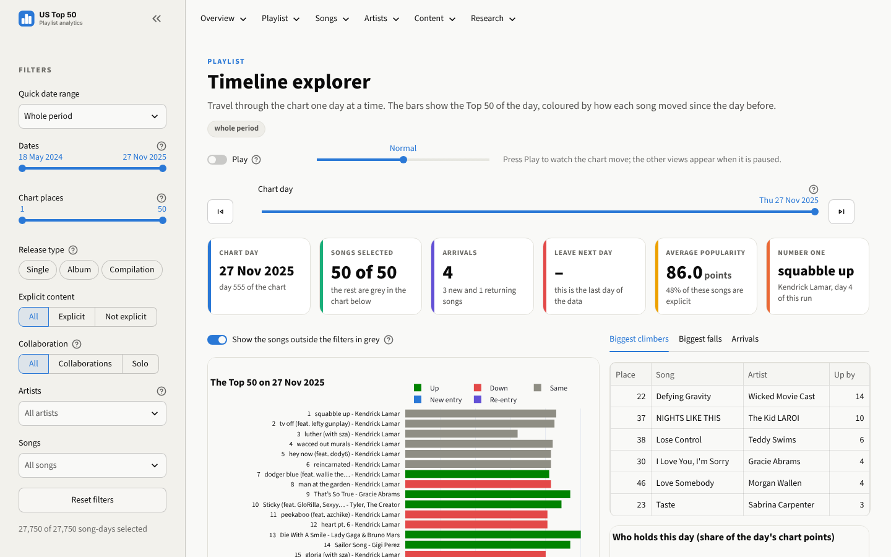
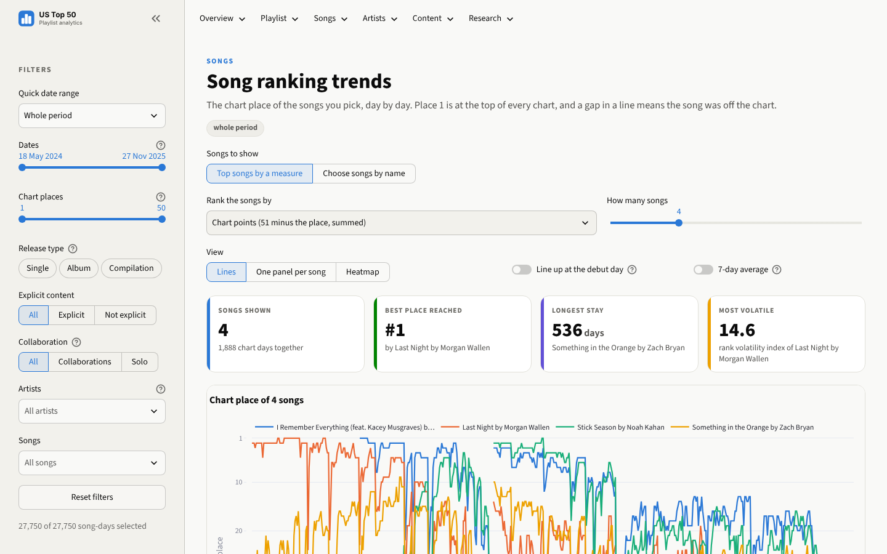
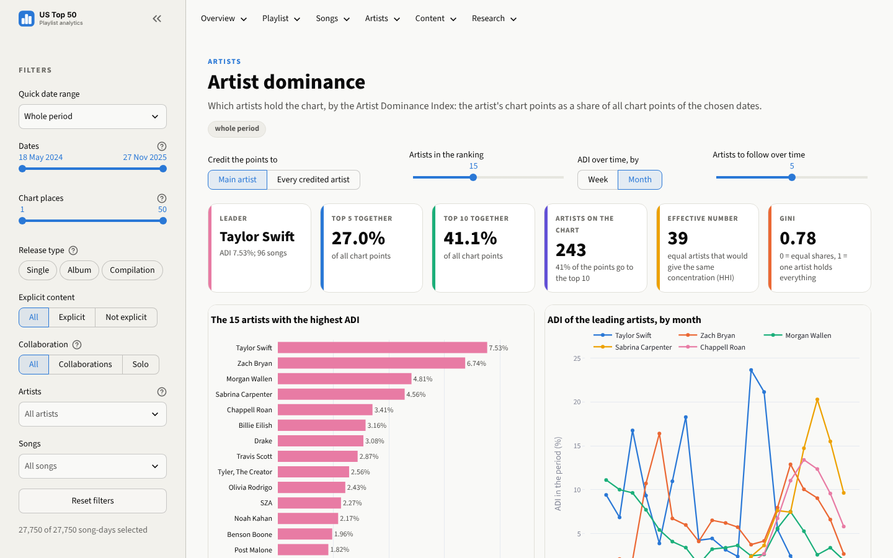
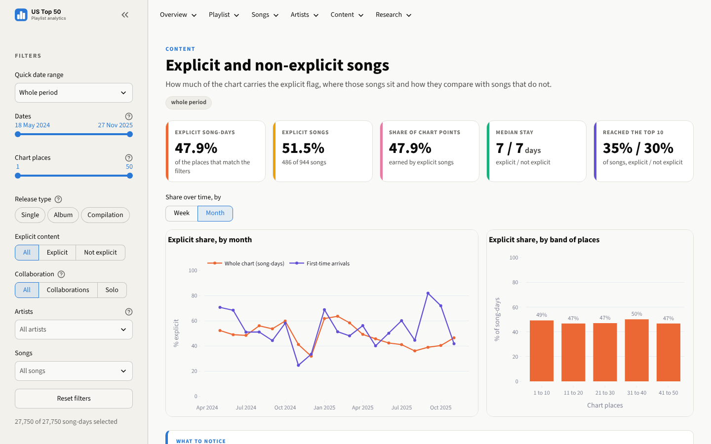
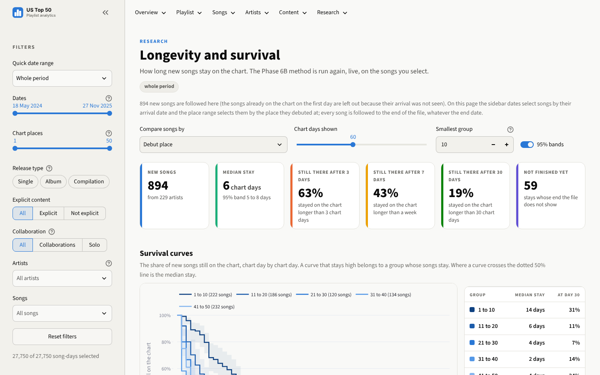
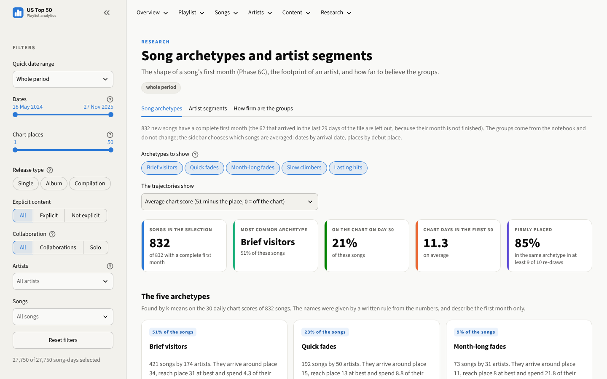

<div align="center">

# United States Top 50 Playlist Performance and Song Popularity Trend Analysis

## Dashboard Link : https://united-states-top-50-playlist-songs-and-album-data-analysis-ll.streamlit.app/

### Atlantic Recording Corporation case study

An end-to-end analytics project: checked data, a tested pipeline with a SQL database, exploratory analysis, statistical evidence, supporting models, an 18-page Streamlit dashboard, a research paper, and an executive summary.




[Research paper](docs/research_paper.md) | [Executive summary](docs/executive_summary.md) | [Dashboard pages](#the-streamlit-dashboard) | [Run it yourself](#getting-started)

</div>

<!-- After you upload the two videos, add their links here. -->

Music charts move every day. A record label that wants to promote artists, time releases, spend its marketing money and manage its catalogue needs to know how songs really behave on a playlist: how long they stay, who dominates, and what goes with a long stay. This project answers those questions from 555 daily snapshots of the United States Top 50 playlist. It is built the way a real analytics project should be: checked data, a repeatable pipeline, tests that allow for how the data are related, and an honest statement of what the data cannot say.

The brief is clear that this is **historical analytics, not prediction**. Every result describes what happened. Nothing here is sold as a forecast, and every recommendation comes with the evidence behind it and a caution.

## Contents

1. [Project at a glance](#project-at-a-glance)
2. [The business problem](#the-business-problem)
3. [Dataset](#dataset)
4. [How the project is built](#how-the-project-is-built)
5. [Key results, with pictures](#key-results-with-pictures)
6. [The Streamlit dashboard](#the-streamlit-dashboard)
7. [Recommendations](#recommendations)
8. [Limitations](#limitations)
9. [Repository structure](#repository-structure)
10. [Getting started](#getting-started)
11. [Notebook guide](#notebook-guide)
12. [Database options](#database-options)
13. [Tests](#tests)
14. [Research paper and executive summary](#research-paper-and-executive-summary)
15. [Tech stack](#tech-stack)
16. [Working rules](#working-rules)
17. [Phase checklist](#phase-checklist)
18. [Author](#author)

## Project at a glance

| Item | Detail |
|---|---|
| Case | Atlantic Recording Corporation: what the daily United States Top 50 playlist says about how songs and artists perform over time |
| Data | `Atlantic_United_States.csv`, one row per song per daily snapshot: 27,800 rows, 27,750 after cleaning |
| Period | 18 May 2024 to 27 November 2025 as recorded in the file: 555 snapshot days, 944 songs, 243 primary artists |
| Scope | Historical analytics, as the brief asks. No forecasts and no causal claims |
| Deliverables | Research paper (30 figures), Streamlit dashboard (18 pages), executive summary |
| Code | About 14,600 lines of Python in `src/` and `app/`, covered by 59 test files (more than 1,000 test functions) |
| Checks | 31 validation checks on the raw file and a 25-test quality gate on the final tables |

**Headline results**

- **Most visits are short.** The typical song spends 7 days on the chart (the average is 29), and 52 songs (5.5%) earn half of all chart points.
- **The first days decide most.** 83% of new songs are still on the chart after day 1, 63% after day 3, 43% after a week and 19% after a month. The median stay is 6 chart days.
- **Songs leave from the bottom.** The last ten places hold 15% of the chart days but 59% of the exits.
- **A few artists hold much of the chart.** The ten biggest artists hold 41% of all chart points, and Taylor Swift alone holds 7.5%.
- **How a song enters matters more than what it is.** Where a song first appears is the clearest signal of how long it stays. Explicit content, collaboration, song length and album size show only small or unclear links. Of ten claims fixed in advance, six are supported, two are suggestive and two are not supported.
- **Early information says something, but not much.** An AUC of 0.68 for a Top-10 debut before the song arrives, up to 0.87 for a later climb after three chart days (a small group of 31 climbers), and nothing for first-week popularity.

**What makes it different**

- **Tests that respect the data.** Songs of one artist are alike and neighbouring days are alike, so a textbook test is too confident: on pure noise it raised a false alarm up to 52% of the time instead of 5%. Every claim is tested twice, the second time with methods that resample whole artists, and the ten p-values are corrected together.
- **Models as a ruler, not a crystal ball.** Models are scored with an artist's songs always on one side of the split, and they measure how much early information says. They are not a forecasting service.
- **A quality gate in front of the data.** 25 automatic tests run on the finished tables. If one fails, nothing is saved and nothing is loaded.
- **Every number stored once.** Each notebook writes the numbers its text quotes into a facts file, and that store refuses to hold the same name twice, so the text cannot drift away from the results.
- **A dashboard that is tested.** All 18 pages are run on the real data through nine filter choices in a row, including a single day and a completely empty selection.

## The business problem

For a record label, playlist behaviour over time matters for four decisions:

- Artist promotion strategies
- Release timing decisions
- Marketing spend optimization
- Catalogue performance analysis

The brief says that stakeholders, despite having daily Top 50 data, lack a clear view of ranking stability against volatility, of how long songs stay relevant, of artist dominance and repeat appearances, and of how song attributes (duration, explicit content, album type) relate to popularity. Without structure, playlist insight stays surface-level and anecdotal. This project gives it that structure.

| The brief asks for | Where it is |
|---|---|
| Research paper (EDA, insights, recommendations) | [`docs/research_paper.md`](docs/research_paper.md), built on notebooks 04 to 06c |
| Streamlit dashboard (live analytics) | [`app/`](app), started with `streamlit run app/streamlit_app.py` |
| Executive summary for government stakeholders | [`docs/executive_summary.md`](docs/executive_summary.md) |
| Playlist timeline explorer, ranking trend charts, artist dominance leaderboard, popularity against rank, explicit against non-explicit | Dashboard pages: Timeline explorer, Ranking trends, Artist dominance, Popularity and rank, Explicit content |
| Date range selector, artist and song filters, rank range slider, album type toggle | The sidebar of the dashboard, obeyed by every page |
| The six KPIs | Defined once (`reports/kpi_dictionary.csv`, `src/features/`) and used everywhere, including the dashboard |
| Power BI dashboard (the brief says "you can also create") | Not built. The Streamlit dashboard is the interactive layer, and the tables in `data/processed/` can be loaded into Power BI or any other BI tool |

## Dataset

The input is one CSV file with ten fields. Each snapshot lists the 50 songs on the playlist that day.

| Field | Meaning |
|---|---|
| `date` | Date of the playlist snapshot |
| `position` | Playlist rank, 1 to 50 |
| `song`, `artist` | Song title and credited artist(s) |
| `popularity` | Popularity score from the Atlantic API, 0 to 100 for each song on each day (not a count of streams) |
| `duration_ms` | Song duration in milliseconds |
| `album_type` | Single or album |
| `total_tracks` | Number of tracks on the release |
| `is_explicit` | Explicit content flag |
| `album_cover_url` | Album artwork link |

| After cleaning | Value |
|---|---|
| Snapshot days | 555 (18 May 2024 to 27 November 2025, as recorded in the file) |
| Chart rows | 27,750 (555 days x 50 places) |
| Different songs | 944 |
| Credited artists | 283 |
| Primary (first-named) artists | 243 |
| Chart points per day | 1,275 (place 1 earns 50 points, place 50 earns 1) |

**Quality checks.** The raw file went through 31 validation checks: 17 passed, 8 raised a warning, 6 were informational and none failed. After cleaning, a quality gate of 25 tests on the final tables (unique date-and-place pairs, every place 1 to 50 present every day, entries equal to exits, artist shares adding up to 100%, and others) passed in full.

**Cleaning decisions.** Nothing was dropped silently. Every decision was logged with its reason (`reports/cleaning_log.csv`).

| Issue found | What was done | Affected |
|---|---|---|
| One date (1 March 2025) held two snapshots | Kept the later block of 50 rows | 50 rows removed |
| 4 of 559 calendar days have no snapshot | Kept as gaps; time is counted in snapshots and no rows are invented | 4 days |
| The same song written with different artist credits | 35 candidate pairs reviewed: 29 are the same song and were merged, 6 are different songs and kept apart | 29 merged |
| Several titles and credits for one song | One title, one fullest artist credit and one label per song | 1,137 rows |
| Popularity of 0 for a song that is on the chart | Treated as missing and repaired from the song's own history; the original column is kept | 189 rows repaired, 18 left empty |
| Compilation releases | Counted as albums in the single-versus-album comparison | 9 songs |

**A caution about the calendar.** The calendar in the file appears to run about one year ahead of real-world dates. For 20 well-known songs, the gap between the real release date and the first chart appearance in the file is 366 to 370 days (`reports/calendar_reality_check.csv`). Days, places and shares depend only on order and counts, so they are not affected. Weekday and month patterns are patterns of the file's own calendar and should not be read as real release days.

## How the project is built



The logic lives in tested modules under `src/`. The notebooks tell the story and call that code, so the same code feeds the notebooks, the dashboard and the tests.

| Phase | What happens | Notebook | Code |
|---|---|---|---|
| 0 | Project setup | | `src/config.py`, `src/logger.py`, `requirements.txt` |
| 1 | Data ingestion and validation (31 checks) | `01_data_ingestion_and_validation` | `src/etl/extract.py`, `src/etl/validate.py` |
| 2 | Cleaning and feature engineering | `02_cleaning_and_feature_engineering` | `src/etl/standardize.py`, `src/etl/clean.py`, `src/features/` |
| 3 | ETL pipeline, quality gate and database | `03_etl_pipeline_and_database` | `src/etl/`, `sql/` |
| 4 | Exploratory analysis: playlist, songs, artists, popularity, content | `04_eda_playlist_song_artist` | `src/eda/` |
| 5 | Hypothesis testing: ten claims, tests that allow for related rows | `05_hypothesis_testing` | `src/inference/` |
| 6A | Supporting models: classification and regression | `06a_supervised_models` | `src/ml/` |
| 6B | Survival analysis: how long does a new song stay? | `06b_survival_analysis` | `src/survival/` |
| 6C | Clustering: shapes of a first month, kinds of artist | `06c_clustering` | `src/cluster/` |
| 7 | Streamlit dashboard: 18 pages, one set of filters | | `app/`, `src/dash/` |
| 8 | Power BI dashboard | skipped on purpose: optional in the brief | |
| 9 | Research paper and executive summary | | `docs/` |

**The six KPIs of the brief**, defined once and used everywhere:

| KPI | What it tells | Definition | In this file |
|---|---|---|---|
| Days on Chart | Longevity | Number of snapshots on which the song appears | Typical song 7 days (mean 29.4) |
| Average Rank | Overall performance (lower is better) | Mean place over the song's chart days | Typical song averages place 29.9 |
| Rank Volatility Index | Stability (higher means less stable) | Standard deviation of the place over the song's chart days | Typical swing of 9.6 places |
| Popularity Score Trend | Listener engagement over time | 7-day rolling mean of the cleaned popularity score inside a run | 89.5 to 86.1, first 30 days against last 30 days (-3.4 points) |
| Artist Dominance Index | Market presence | Artist's chart points / all chart points x 100 | Taylor Swift 7.5%; the ten biggest artists 41% |
| Explicit Content Share | Content mix | Share of the 50 daily rows flagged explicit | 48% of chart entries |

## Key results, with pictures

Every picture below is an output image of the project's notebooks, saved in [`reports/figures`](reports/figures) (89 charts in all). The research paper uses 30 of them with a note under each.

### How songs move and how long they stay (Phase 4)


*Each row is a song and each column a day. Darker cells are places nearer the top, and blank cells mean the song was off the chart. 22 of the 25 longest-running songs left the chart at least once and came back, so even the most durable songs rarely stay in one unbroken stretch.*


*Where a run begins and where it ends. 25% of first runs begin in the top 10, but 84% of returns come back at the bottom, and 69% of runs end in places 41 to 50.*


*The ten biggest climbs inside any seven days, and the slowest gradual fades. The fastest riser gained 43 places in a week (46 to 3).*


*Songs sorted into five classes by days on the chart. For each class, a light bar shows its share of songs and a dark bar its share of chart points. Flash songs (1 to 3 days) are a third of all songs and earn 1.4% of the points. Evergreen songs (181 days or more) are 3.8% of the songs and earn 38%.*

### Who holds the chart (artists)


*Left: the share of all chart points held by the biggest artists. Right: the Lorenz curve across all 243 artists; the further it bends away from the straight line, the more concentrated the chart. Taylor Swift holds 7.5%, the top ten hold 41%, and the Gini coefficient is 0.78.*


*Leadership is not fixed: 14 different artists led at least once in the 19 months, and the effective number of artists ran from 11.1 to 37.1. A big share is reached in two ways: with many songs (Taylor Swift, 96 songs at 21 days each) or with a few that last (Morgan Wallen, 10 songs at 167 days each).*

### Popularity and content


*The popularity score is a loose companion of the chart: the link with place is 0.25 across song-days, 0.16 across songs and 0.21 within songs.*


*The 28-day moving average of the chart's daily average score slid 3.2 points for all songs and 1.9 points for established songs. The dashboard and the KPI tile also show the change between the first and last 30 days (3.4 points); the two numbers measure the slide in slightly different ways.*


*Explicit against not explicit, single against album track, and collaboration against solo. Singles stay longer but do not reach the top 10 more often. Explicit songs reach the top 10 more often but do not stay longer.*

### Ten claims, tested with methods that allow for related rows (Phase 5)


*Songs of the same artist resemble each other (left), and each day resembles the day before (right). The 944 songs are worth only about 365 to 561 independent ones.*


*What happens if that is ignored. On pure noise, a textbook test raises a false alarm up to 52% of the time instead of 5%. Resampling whole artists, or blocks of days, keeps it at 5 to 7%.*

| Claim | Planned test | Primary test | After Holm | Effect (95% interval) | Verdict |
|---|---|---|---|---|---|
| H1 Explicit songs reach the top 10 more often | p = 0.021 | p = 0.042 | p = 0.17 | +7.0 points (+0.3 to +13.8) | Suggestive |
| H2 Singles stay longer than album tracks | p < 0.001 | p = 0.003 | p = 0.018 | x1.64 in typical stay (1.18 to 2.27) | Supported |
| H3 Popularity differs between the top 10, places 11-20 and 21-50 | p < 0.001 | p = 0.002 | p = 0.017 | +7.4 points, top 10 against 11-20 (+3.2 to +11.7) | Supported |
| H4 The chart's average popularity fell | p < 0.001 | p = 0.002 | p = 0.017 | -0.47 per 100 days (-0.76 to -0.17) | Supported |
| H5 Entry place changes how long a run lasts | p < 0.001 | p < 0.001 | p < 0.001 | correlation -0.36 (-0.43 to -0.28) | Supported |
| H6 First-time entries are concentrated on Monday and Tuesday | p < 0.001 | p < 0.001 | p < 0.001 | 67% (58 to 75%) against 29% if evenly spread | Supported |
| H7 Longer songs reach the top 10 more often | p = 0.009 | p = 0.003 | p = 0.018 | +3.0 points per length band (+1.0 to +4.9) | Supported |
| H8 The chart is more concentrated in some months | p = 0.39 | p = 0.39 | p = 0.78 | +2.9 effective artists (-3.0 to +9.3) | Not supported |
| H9 Collaborations reach the top 10 less often | p = 0.35 | p = 0.44 | p = 0.78 | -4.3 points (-15.4 to +6.8) | Not supported |
| H10 Explicit songs stay longer only among singles | p = 0.019 | p = 0.045 | p = 0.17 | x1.76 ratio of ratios (1.01 to 3.05) | Suggestive |

A claim is **Supported** if its Holm-adjusted p-value is below 0.05, **Suggestive** if its primary p-value is below 0.05 but the adjusted one is not, and **Not supported** otherwise.


*One row per claim: the effect with its 95% interval, a size word, the primary and Holm p-values and the verdict. Read across a row, not only down the verdict column: only H5, the link between entry place and run length, has a medium effect. The rest are small or negligible.*


*The same ten tests without Taylor Swift, the artist with the most songs. Nothing reverses, and three verdicts weaken (H4, H7 and H10).*

### How long does a new song stay? (Phase 6B, survival analysis)

A stay is a song's first run of chart days. A song that is absent for seven snapshot days has left. A stay that is still running on the last day is *censored*, which means "at least this long", and is never counted as finished. No survival library is used: the curves, the hazard model and the Cox model are written in `src/survival/`.


*83% of new songs remain after day 1, 63% after day 3 and 43% after a week. The median stay is 6 chart days. The shaded band is the margin of error widened to allow for the songs of one artist being alike.*


*The first chart day is about 32 times as dangerous as the days after day 120.*


*The last ten places hold 15% of the chart days but 59% of the exits. A day in places 46 to 50 has a 23% chance of being the last of a stay, against 1.7% in places 21 to 25. These are rates of past stays: a song's place is a sign that it is fading, not a lever that moves it.*


*A forest plot of the main model, which holds the inputs against each other. Debut place and the size of the album drop are clear of 1. Single, explicit, collaboration, length and the artist's record are not. A chart day of a song that debuted in places 31 to 40 is about four times as likely to be its last as one of a song that debuted in the top 10.*

### Kinds of chart life (Phase 6C, clustering)

Each song's first 30 chart days become a row of 30 chart scores (51 minus the place, 0 off the chart) and are grouped with k-means. The number of groups is chosen with the silhouette and with stability when whole artists are drawn again. k-means, the silhouette and the stability checks are written in `src/cluster/`.


| Archetype | Songs (share) | Average arrival place | Average days on chart in the first 30 | On the chart on day 30 | Shape |
|---|---|---|---|---|---|
| Brief visitors | 421 (51%) | 33.5 | 4.3 | 5% | Low arrival, gone by about day 2 |
| Quick fades | 192 (23%) | 14.6 | 8.8 | 2% | High arrival, gone by about day 7 |
| Month-long fades | 73 (9%) | 11.0 | 21.8 | 12% | High arrival, fades out by about day 22 |
| Slow climbers | 69 (8%) | 39.3 | 28.5 | 90% | Low arrival, climbs to an average best place of 14.7 |
| Lasting hits | 77 (9%) | 9.8 | 29.9 | 97% | High arrival, stays high |

*Lasting hits stay near their starting height. The three fading groups lose half of their first-day height by day 3, day 7 and day 15. When whole artists are re-drawn 1,000 times, brief visitors are the firmest group (agreement 0.97), lasting hits and quick fades follow (0.90 and 0.91), and month-long fades and slow climbers are the softest (0.82 and 0.83). Read the groups as useful descriptions, not as hard boundaries.*


| Segment | Artists (share) | Songs | Share of all chart days | Typical profile | Examples |
|---|---|---|---|---|---|
| Catalogue artists | 32 (13%) | 610 | 59% | Median 14 songs and 218 days present | Taylor Swift, Zach Bryan, Morgan Wallen |
| Mid-chart stayers | 86 (35%) | 154 | 25% | One song, 55.5 chart days at the median | SZA, Benson Boone, Teddy Swims |
| Top-chart hit-makers | 32 (13%) | 63 | 15% | One song, 97 chart days, 42% of days in the top 10 | Doja Cat, Tate McRae, Gunna |
| Passing visitors | 93 (38%) | 117 | 2% | One song, 3 chart days at the median | One Direction, USHER, Cardi B |

*The colour shows how far each segment is from the average artist (blue above, red-orange below). These are descriptions of historical data, not boxes for sorting a new song.*

### What early information adds (Phase 6A, supporting models)

Seven questions are asked about songs that arrived after the first day of the file, each at the moment when a label could ask it, with more and more information (release details, timing, the artist's earlier record, the debut-day chart, the first three chart days). Every score comes from forecasts for artists that the model has never seen, and a plain straight-line model always runs beside the flexible ones. The models are a **measuring device**: they show how much each block of information adds, not what to do.


*Three days of chart history lift boosting's AUC for a later Top-10 climb from 0.77 to 0.87, and give a clear gain for a stay of 15 or more days. The climb result rests on only 31 climbers, so its band is wide.*

| Question (asked when) | Songs | Score and chance level | Best at the last step (95% band) |
|---|---|---|---|
| C1. Debut in the Top 10? (before the song arrives) | 894 | AUC; 0.50 | 0.68 (0.64 to 0.73) |
| C2. Climb into the Top 10 within 30 days, for songs that debuted outside it (debut day) | 632 | AUC; 0.50 | 0.71 (0.63 to 0.78) |
| C3. Stay class in the first 30 days: Flash, Short or Sustained (debut day) | 832 | Balanced accuracy; 0.33 | 0.51 (0.47 to 0.55) |
| R1. Popularity in the first week (debut day) | 878 | R-squared; 0 | 0.02 (-0.26 to 0.17) |
| R2. Chart days in the first 30 (debut day) | 832 | R-squared; 0 | 0.22 (0.15 to 0.28) |
| E1. Later climb into the Top 10, after three days outside it | 359 | AUC; 0.50 | 0.87 (0.81 to 0.93) |
| E2. Stay of 15 or more days, after three days outside the Top 10 | 359 | AUC; 0.50 | 0.84 (0.78 to 0.89) |

Before a song arrives, the artist's record adds most. On the debut day, the chart of that day adds most. After three days, the first three chart days add most. First-week popularity cannot be told from the early information at all.

## The Streamlit dashboard

An interactive version of the same measures: 18 pages in six sections, one set of filters, and the same definitions as the notebooks and the paper.

```
streamlit run app/streamlit_app.py
```

It opens at `http://localhost:8501`. Stop it with Ctrl+C. If Streamlit asks for an email address on the very first start, press Enter to skip it. To use another port add `--server.port 8502`. It needs Streamlit 1.50 or newer, which `pip install -r requirements.txt` installs.

| Section | Page | What it shows |
|---|---|---|
| Overview | Executive summary | The six KPIs of the brief, the leading artists, how much of the chart changes, and what the analysis found |
| Playlist | Timeline explorer | The Top 50 of any day, a replay day by day, and a comparison of two days |
| Playlist | Chart movement | Arrivals, exits and turnover over time, a calendar of busy days, the weekday pattern |
| Playlist | Entry and exit | Where songs enter the chart, where they leave from, and how long they stay |
| Songs | Ranking trends | Chosen songs through the chart: lines, small multiples, heatmap, aligned at the debut day |
| Songs | Risers and decliners | Who climbed or fell most over a window of days, and over whole stays |
| Songs | Song leaderboard | Every song with its KPIs; sort, search and download |
| Songs | Song profile | One song in detail: its path, popularity, runs, and how it compares with the others |
| Artists | Artist dominance | The Artist Dominance Index (ADI) leaderboard and its change over time |
| Artists | Artist profile | One artist in detail: ADI over time, every song as a timeline bar, release mix |
| Artists | Concentration | HHI, effective number of artists, top-N share, Lorenz curve |
| Content | Popularity and rank | How the popularity score relates to the chart place, for song-days and for songs |
| Content | Explicit content | Explicit against not explicit: share over time, by place, song by song with effect sizes |
| Content | Release and collaboration | Singles, albums, compilations, collaborations, release size and song length |
| Research | Longevity and survival | How long new songs stay (Phase 6B), for any group, with the uncertainty band |
| Research | Archetypes and segments | The five first-month patterns of songs and the four kinds of artist (Phase 6C) |
| Research | Evidence | The hypothesis tests of Phase 5, the findings of Phase 4, the checks of Phase 6A |
| Research | Data and methods | Data quality, the definition of every KPI, the data dictionary, what is and is not claimed |

**What it looks like** (the first screen of seven pages, whole chart, no filters set):














**The filters** are in the sidebar and every page obeys them: a quick date range and a date slider, a chart-places slider (for example places 1 to 10 only), the release type (single, album, compilation), explicit or not, collaboration or solo, any artists and any songs, and a *Reset filters* button. Under each page title a row of small labels says which filters are active, and the sidebar says how many song-days are selected. A choice that leaves nothing gives a plain message, not an error.

**How it is built.** The calculations are in `src/dash/` and use only pandas and NumPy, so they are tested without a browser. The screens are in `app/`: `streamlit_app.py` is the entry file, `nav.py` the list of pages, `ui/` holds the colours (the same palette as the notebook charts), the chart builders (Plotly) and the page building blocks, and `views/` has one file per page, each with a `render()` function. The six tables are read once per server and shared by every page. The dashboard reads local files only. The only things that use the internet are the optional album-cover switches on the Timeline explorer and the Song profile, and they are off by default.

**How to read it.** Everything is a description of the historical playlist: associations, not causes, and nothing here predicts or recommends a song. A few pages run a small test on the songs you have selected. Those quick p-values treat songs as independent, which is too eager when several songs belong to one artist, so the verdicts of Phase 5 (which allow for artists and correct for many tests) are the ones to quote.

The Research pages also read the result files that notebooks 04 to 06c write into `reports/`. If one is missing, that page says which notebook creates it and every other page keeps working.

## Recommendations

The brief names four areas where playlist behaviour matters and asks for recommendations, while keeping the project to historical analytics. The two fit together in one way: each item is a **use of a pattern that held in the past**, with the evidence for it and a caution. None is a forecast, and none says that changing a song or a campaign would change what happens. The full text is in Section 14 of the [research paper](docs/research_paper.md).

| # | Area | What to do | Evidence from the history | Caution |
|---|---|---|---|---|
| 1 | Artist promotion | Use the first three chart days as a review checkpoint | After three chart days, songs sorted into risk thirds had median stays of 33, 14 and 5 chart days (C-index 0.751 against 0.636 on the arrival day) | Groups of past stays: not a forecast for one song, and not proof that support changes a stay |
| 2 | Artist promotion | Treat several songs arriving together as one campaign | 30% of songs that arrived alone were still on the chart at day 30, against 15% for two to four songs and 10% for five or more | An association: no case shows the same songs arriving differently |
| 3 | Release timing | Confirm the file's calendar before building any weekday rule | 67% of first-time entries fall on Monday and Tuesday (29% if evenly spread), but the calendar runs about a year ahead of real dates | Check the dates against Atlantic's own release records |
| 4 | Release timing | Do not choose single against album track on stay length alone | Singles stay a median of 13 days against 6, but the gap disappears once debut place and the other inputs are held fixed (hazard ratio 1.01) | An association among past songs |
| 5 | Marketing spend | Read the bottom of the chart as a watch-list, not a lever | The last ten places hold 15% of chart days and 59% of exits; a day in places 46 to 50 has a 23% chance of being the last | Rates of past stays; the data cannot show that spend would lengthen a stay |
| 6 | Marketing spend | Put a value on a climb or a long stay before judging any early-signal rule | Backing the best-scored 10% after three days pays back only if a climb is worth more than 2.2 times the cost of promoting one song | Rests on 16 climbers; the file holds no spend data |
| 7 | Catalogue performance | Monitor concentration and the catalogue artists every month | Ten artists hold 41% of chart points; 32 catalogue artists (13%) hold 59% of chart days | Shares of this playlist, not of Atlantic's own catalogue |
| 8 | Catalogue performance | Describe each artist by breadth and depth, each song by its 30-day shape | Taylor Swift: 96 songs at 21 days each; Morgan Wallen: 10 songs at 167 days each; 9% of songs are lasting hits | Shapes are known only after a month and are not hard boundaries |
| 9 | Content | Do not steer content decisions with this chart | Explicit content, collaboration, length and album size show no clear effect on how soon a stay ends | Not significant is not the same as equal |
| 10 | Data | Collect what is missing, then refresh every month | Real release dates, which artists and releases are Atlantic's, promotion and spend by date, stream counts | One chart in one period; to learn whether support lengthens stays, a planned comparison is needed |

## Limitations

- **One chart, one period.** The file runs from 18 May 2024 to 27 November 2025 as recorded, with 4 of the 559 calendar days missing. The patterns are steady inside it, but nothing shows that they would hold in another year or on another list.
- **The calendar of the file.** Its dates appear to run about a year ahead of real dates, so weekday and month patterns are patterns of the file.
- **The edges of the file.** 50 songs were already on the chart on day one, so their starts are unknown, and 59 of the 894 stays were still running on the last day. Survival methods handle this, but songs near the edges say less than songs in the middle.
- **Songs of one artist are alike.** The 944 songs carry less independent information than the count suggests. The tests allow for this, which makes their bands wider.
- **A score, not streams.** The popularity score runs from 0 to 100. The file holds no streams, revenue, spend or label information, and it does not say which artists are Atlantic's, so every share is a share of this playlist.
- **Association, not cause.** Odds ratios, hazard ratios, importances and groups describe how songs in this file relate to each other. The file holds no comparison that could show what a campaign, or a change to a song, would do.
- **Small counts and wide bands.** Only 56 songs climb in the debut-day question and 31 in the three-day question. Ten claims were tested, so their p-values were adjusted together. A claim that is not supported means the data did not show it, not that nothing is there.
- **Choices made in cleaning.** Other reasonable choices would move some numbers a little. Every choice is logged.
- **Models are measuring tools.** Their scores say how much the early information says, not what to do. The break-even figures were chosen on the songs they are scored on, so they are slightly flattering.

## Repository structure

```
atlantic-top50-analytics/
|-- app/                     Phase 7: the Streamlit dashboard
|   |-- streamlit_app.py     the only file that Streamlit runs directly
|   |-- nav.py               the list of the 18 pages
|   |-- ui/                  colours, chart builders, page building blocks, shared state
|   `-- views/               one file per page, each with a render() function
|-- data/
|   |-- raw/                 the original CSV, never edited
|   |-- interim/             checkpoints between pipeline stages (validated and cleaned data)
|   |-- processed/           the seven analysis tables as Parquet and CSV (what the dashboard reads)
|   `-- warehouse/           the SQLite database, created by the pipeline (not stored in Git)
|-- docs/
|   |-- research_paper.md        the research paper, with its 30 figures
|   |-- executive_summary.md     the executive summary, with its 6 figures
|   `-- dashboard/               screenshots of seven dashboard pages
|-- notebooks/               one notebook per phase: 01 to 06c
|-- reports/                 result tables, facts files, scorecards, logs, data dictionaries
|   `-- figures/                 the 89 charts of Phases 4, 5, 6A, 6B and 6C (PNG, 150 dpi)
|-- sql/                     schema, views and the 12 KPI queries (SQLite, PostgreSQL, MySQL)
|-- src/
|   |-- config.py            paths, constants and column lists, all in one place
|   |-- logger.py            one logger for the screen and for logs/pipeline.log
|   |-- etl/                 extract, validate, standardize, clean, quality gate, documentation, load, run_pipeline
|   |-- features/            the KPI and feature calculations
|   |-- eda/                 chart style, concentration measures (HHI, Gini), chart runs, facts and findings
|   |-- inference/           classical tests, tests for related rows (wild and block bootstrap), power,
|   |                        corrections for many tests, the hypothesis register
|   |-- ml/                  modeling table, validation by artist, models, metrics, explanations, benchmark
|   |-- survival/            stays and censoring, survival and hazard estimators, Cox model
|   |-- cluster/             first-month trajectories, k-means and its stability checks, artist features
|   `-- dash/                the calculations behind the dashboard: plain pandas, no Streamlit
|-- tests/                   59 test files (pytest)
|-- .streamlit/              the dashboard's settings (colours, no usage statistics)
|-- requirements.txt
|-- requirements-dev.txt
|-- pytest.ini
`-- .env.example             template for the database settings
```

## Getting started

Put `Atlantic_United_States.csv` in `data/raw/`, open this folder in VS Code, and run these commands in the terminal:

```
python -m venv .venv
.venv\Scripts\activate
pip install -r requirements.txt
python -m src.etl.run_pipeline
streamlit run app/streamlit_app.py
```

On macOS or Linux, activate the environment with `source .venv/bin/activate` instead. If `data/processed/` is already in the repository, the pipeline step can be skipped.

**What the pipeline does.** It runs nine steps in a fixed order and prints one line per step:

1. Extract the raw CSV.
2. Validate it and write the data-quality scorecard.
3. Standardize artists, titles and song identity (`track_id`).
4. Clean: repair what can be repaired and cut every song's history into chart runs.
5. Build the KPIs and the seven analysis tables.
6. Run the quality gate: 25 automatic tests on the finished tables.
7. Write the data dictionary and the KPI dictionary.
8. Save the files.
9. Load the database.

If any gate test fails, the pipeline stops before step 8, so a bad run can never overwrite good files. The reasons are kept in `reports/quality_gate.csv`, `logs/pipeline.log` and `reports/last_run.json`. Useful options: `--no-db` saves the files but does not load a database, `--db postgresql` or `--db mysql` loads that database instead of SQLite, and `--force-replace` lets it overwrite tables that it did not create itself (use with care).

**Order of the notebooks.** Run the pipeline first. Then open each notebook in VS Code, pick the Python environment of this project as the kernel, **restart the kernel** and choose *Run All*. Restart every time: the notebook's store of numbers refuses to hold the same name twice, which is how it shows that no number was silently replaced.

## Notebook guide

| Notebook | What it does | Run it after | Writes |
|---|---|---|---|
| `01_data_ingestion_and_validation` | Reads the raw file and runs the 31 checks | the raw CSV is in place | data-quality scorecard |
| `02_cleaning_and_feature_engineering` | Standardizes, cleans, builds features, logs every decision | 01 | cleaned tables, cleaning log |
| `03_etl_pipeline_and_database` | Runs and explains the pipeline and the SQL database | the raw CSV is in place | `data/processed/`, the SQLite database |
| `04_eda_playlist_song_artist` (about a minute) | The blocks of the brief: KPIs, ranking, songs, artists, popularity, content | the pipeline | 32 charts `p4_*.png`, `p4_facts.json`, `p4_eda_findings.csv` |
| `05_hypothesis_testing` (about a minute) | Ten claims, each tested twice, corrected together, stress-tested | the pipeline and 04 | 17 charts `p5_*.png`, `p5_hypothesis_register.csv`, `p5_robustness.csv` |
| `06a_supervised_models` (several minutes; about 8 on a two-core computer) | Seven questions, artist-grouped validation, explanations, break-even tables | the pipeline | 17 charts `p6a_*.png`, `p6a_model_register.csv` and five more tables |
| `06b_survival_analysis` (under half a minute) | Stays and censoring, survival curves, hazard model, Cox model | the pipeline | 12 charts `p6b_*.png`, `p6b_stays.csv` and the survival tables |
| `06c_clustering` (about a minute) | Five song archetypes, four artist segments, ten stress reruns | the pipeline and 06b | 11 charts `p6c_*.png`, `p6c_song_archetypes.csv` and the cluster tables |

Every notebook also writes a `*_facts.json` file with each number its text quotes. The sentences were written from one run (pandas 3.0.5, NumPy 2.5.3, SciPy 1.18.1, scikit-learn 1.9.1). The notebooks were also run on the oldest versions the project allows (pandas 2.2.0, NumPy 1.26.4, SciPy 1.12.0, scikit-learn 1.4.0): sentences printed the same, and boosting and forest scores moved by about 0.001 as a rule and by 0.01 at most. If a printed number differs a little from the sentence next to it, trust the printed number.

## Database options

- **SQLite** is the default. It needs no installation: the pipeline creates `data/warehouse/atlantic_top50.db`.
- **PostgreSQL**: create an empty database, copy `.env.example` to `.env`, set `DB_TYPE=postgresql` and the host, port, database name, user and password, then run `python -m src.etl.run_pipeline`.
- **MySQL**: the same with `DB_TYPE=mysql` (port 3306). The code is written for MySQL but has not been run against a real MySQL server. Create the database with a case-sensitive collation, for example `CREATE DATABASE atlantic_top50 CHARACTER SET utf8mb4 COLLATE utf8mb4_bin;`, otherwise two artist names that differ only by an accent or a capital letter can count as the same key.

Every run is a full refresh inside one transaction (drop, create, insert, verify counts and a checksum), so running the pipeline twice gives the same database and a failed run leaves the old data in place. Each run also adds one row to the `etl_run_log` table. The `sql/` folder holds the schema, the views and the 12 KPI queries. Never commit your `.env` file: it is listed in `.gitignore`.

## Tests

```
pip install -r requirements-dev.txt
pytest -q
```

The tests use temporary folders and never touch your own data or database. Run one area at a time with `-k` (this form also works in Windows PowerShell, which does not expand a `*` in a file name):

| Area | Command |
|---|---|
| Phase 5, hypothesis tests | `python -m pytest tests -q -k "test_inference_ or test_notebook_05"` |
| Phase 6A, supervised models | `python -m pytest tests -q -k "test_ml_ or test_notebook_06a"` |
| Phase 6B, survival analysis | `python -m pytest tests -q -k "test_survival_ or test_notebook_06b"` |
| Phase 6C, clustering | `python -m pytest tests -q -k "test_cluster_ or test_notebook_06c"` |
| Phase 7, dashboard | `python -m pytest tests -q -k "test_app_ or test_dash_"` |

The dashboard tests check the wording helpers, the colours, the chart builders (including empty input), the page building blocks (escaping of names, closed tags), the menu list, and every one of the 18 pages on the real data through nine filter choices in a row, and again with the result files missing. The page tests are skipped when `data/processed/` has not been built, and they take about a minute. The dashboard and its tests were run on Streamlit 1.50 and 1.67, Plotly 5.20 to 7.1 and pandas 2.2 to 3.1.

## Research paper and executive summary

| Document | What it is |
|---|---|
| [Research paper](docs/research_paper.md) | Data, methods, findings (chart movement, songs, artists, popularity, content), ten claims tested, survival analysis, kinds of chart life, supporting models, discussion, ten recommendations, limitations, conclusion and references. 30 figures, each with a short note |
| [Executive summary](docs/executive_summary.md) | Five pages in plain language for non-technical readers: the headline, the six key numbers, six findings, what the data do and do not support, and what comes next. Six figures, each with a short note |

Every number in both documents is read from the results files that the notebooks write, and every figure is a saved notebook output.

## Tech stack

| Area | Tools |
|---|---|
| Language | Python |
| Data | pandas, NumPy, PyArrow (Parquet), SciPy |
| Statistics and models | statsmodels, scikit-learn. The Kaplan-Meier curves, hazard model, Cox model, k-means, silhouette and stability checks are written in `src/` |
| Charts | Matplotlib and seaborn (notebooks), Plotly (dashboard) |
| Dashboard | Streamlit |
| Databases | SQLAlchemy 2 with SQLite (default), PostgreSQL (psycopg2) or MySQL (PyMySQL) |
| Notebooks | VS Code with ipykernel |
| Testing | pytest |

## Working rules

- Raw data is never edited. Every phase reads the previous phase's output and writes a new file.
- Every cleaning decision is written in a decision log and can be traced to a flag column.
- The identity of a song is `track_id`, never the title.
- Rounding follows the Excel, SQL and Power BI rule (half up: 4.625 becomes 4.63), so the same number appears in every tool.
- Data that fails the quality gate is never saved or loaded.
- A test that counts related rows (songs of one artist, neighbouring days) as independent never decides a claim. It is shown beside the test that does.

## Phase checklist

- [x] Phase 0 - Project setup
- [x] Phase 1 - Data ingestion and validation
- [x] Phase 2 - Cleaning and feature engineering
- [x] Phase 3 - ETL pipeline and database load
- [x] Phase 4 - Exploratory data analysis
- [x] Phase 5 - Hypothesis testing: ten claims, tests that allow for related rows, corrections, stress tests
- [x] Phase 6A - Supporting models: classification and regression
- [x] Phase 6B - Survival analysis: how long a new song stays
- [x] Phase 6C - Clustering of song and artist trajectories
- [x] Phase 7 - Streamlit dashboard: 18 pages, one set of filters
- Phase 8 - Power BI dashboard: skipped on purpose. It is optional in the brief, and the Streamlit dashboard is the interactive layer
- [x] Phase 9 - Research paper and executive summary

## Author

**Rishikesh Kashyap Ojha**, data analyst, Jamshedpur, India.

[GitHub](https://github.com/Rishikeshcode07) | [LinkedIn](https://www.linkedin.com/in/rishi-ojha07) | [Portfolio](https://my-portfolio-coral-chi-47.vercel.app)

The dataset `Atlantic_United_States.csv` and the project brief come from the Atlantic Recording Corporation case. The popularity score is the one supplied in that file. 
